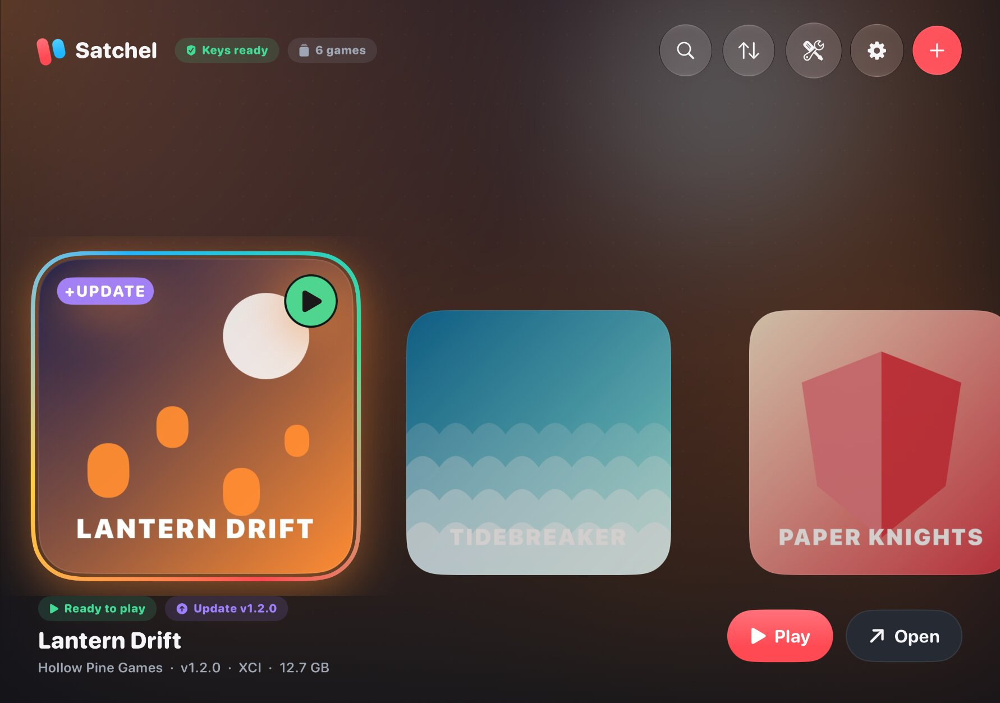
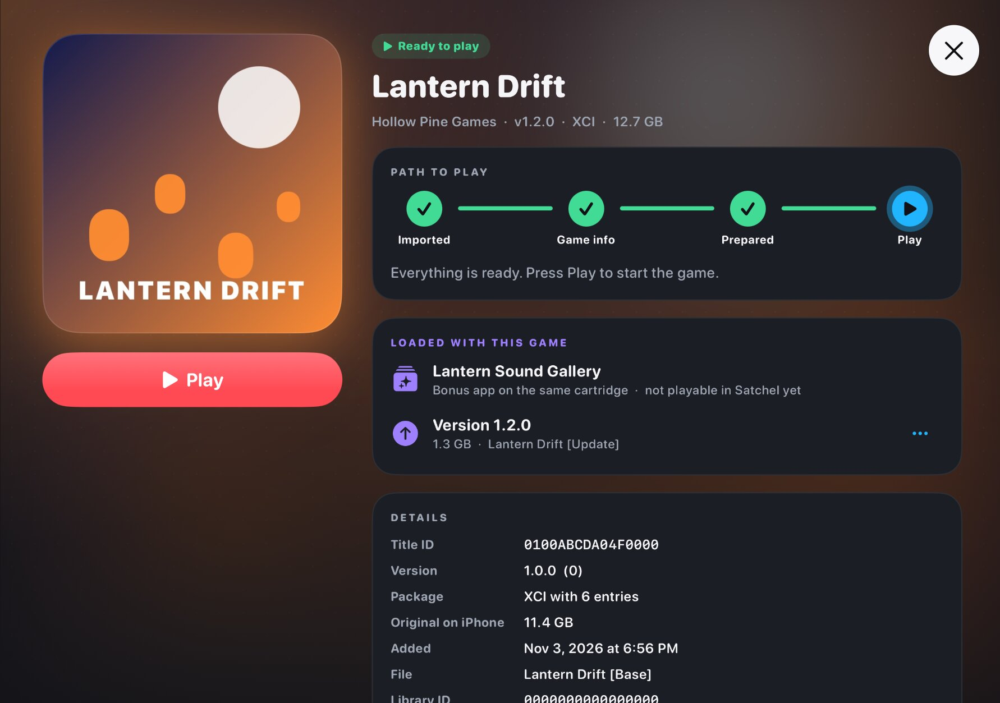
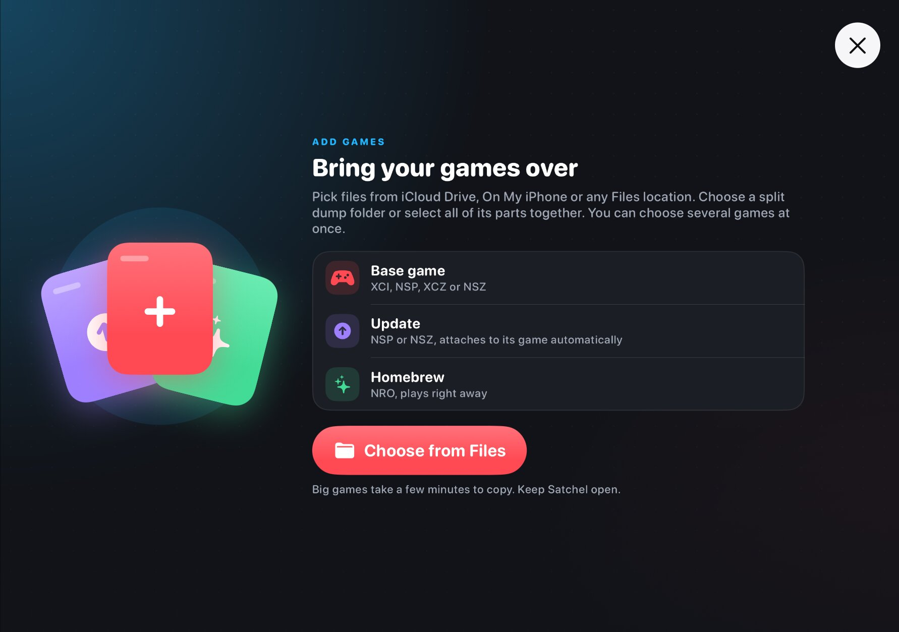
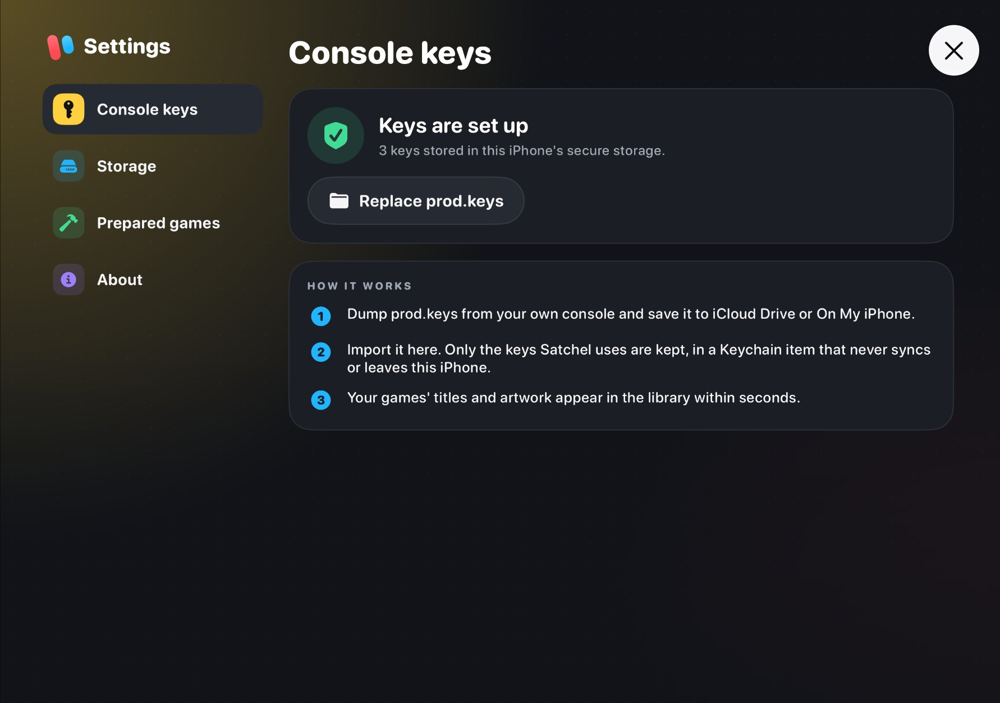

# Satchel

Satchel is an experimental iPhone app that imports your own Nintendo Switch game dumps
from iCloud or Files, prepares them on the phone, and runs them natively. There is no
per-game computer step: decryption, the ARM64 rewrite, packaging, code signing and shader
translation all happen on the iPhone.

It is sideloaded, signed with your own Apple developer certificate, and built for the
iPhone Duo on iOS 27.1 in landscape. It is a research project, not a finished product.
Read [the compatibility list](COMPATIBILITY.md) and [the roadmap](ROADMAP.md) before
expecting anything to work.

<table>
  <tr>
    <td></td>
    <td></td>
  </tr>
  <tr>
    <td align="center">Library</td>
    <td align="center">Game page</td>
  </tr>
  <tr>
    <td></td>
    <td></td>
  </tr>
  <tr>
    <td align="center">Add games</td>
    <td align="center">Console keys (your own prod.keys, kept in the Keychain)</td>
  </tr>
</table>

Screens are from the iOS Simulator on the iPhone Duo's open inner screen, with a fictional
library. The README deliberately shows no frames or artwork from Nintendo's games.

## What works today

Measured on one iPhone Duo (A20 Pro, iOS 27.1). Dates are in the compatibility list.

- The Legend of Zelda: Tears of the Kingdom 1.4.3 boots from a package prepared entirely
  on the phone, loads saves, and holds 28 to 30 FPS in the open world at the 30 FPS cap
  and 0.65 render scale. A two hour session ran without a crash.
- Super Mario Odyssey 1.4.1 runs at its own 60 FPS; it was played into the Cap Kingdom
  with a Bluetooth controller.
- Castlevania: Belmont's Curse boots to its intro and gameplay at a steady 30 FPS, with
  hitches when a new shader is first compiled.
- Mario Kart 8 Deluxe boots and plays, with shader stalls and memory growth between
  scenes still being worked on.
- Import of XCI, XCZ, NSP and NSZ files (including split dumps) from Files or iCloud
  Drive, with updates and DLC. Titles and artwork are read from your own game files.
- Prepare runs as a background task with system progress, and signs the game code on the
  phone with your Apple Development identity.
- A pause menu (three-finger double tap, on-screen button, or holding Home on a
  controller) with resume, return to library, quit, screen fit, an FPS counter, audio
  volume, touch size and opacity, and a controller layout view. Settings > Controllers
  configures the shortcut. Home stays reserved; Menu and Options work normally alone,
  then both are suppressed from chord completion until both are released.
- Controller profiles use GameController input names, saved as JSON per product
  category beside each title's player settings, with global defaults. The settings
  page includes live inputs, stick visualization and a radial dead zone. D-pad and
  stick edges move focus through the library, game actions and pause menu.
- Xbox, DualSense and Pro Controller support. Touch controls hide when a controller is
  connected.

Game-page additions awaiting hardware validation: per-title FPS target, render scale,
screen mode, haptics and pipeline mode with defaults, override markers and reset. The
save manager lists dated, sized backups, keeps the newest three, restores with
confirmation and exports through the share sheet. Import accepts title-bound Satchel
ZIPs, not arbitrary emulator archives. See [the test guide](docs/testing.md).

Native import format limits, Prepare read measurements and synthetic coverage are
documented in [the importer validation guide](docs/importer-validation.md). These Mac
checks do not add phone compatibility claims.

## What does not work yet

- Only four games have been tried. Any other game may fail at import, Prepare or boot.
  The app records exactly where (missing service, crash address, shader) so a report is
  useful. See [COMPATIBILITY.md](COMPATIBILITY.md).
- A pinned-input bootstrap rebuilds native dependencies in an isolated root using local
  caches and installed tools. Five additional tool sources now have URL and hash pins.
  Public synthetic shader parity now validates and stages fresh shader dependencies
  without game data. Full unsigned-app validation and the remaining clean-Mac tool
  pins and standalone recipes are still open. This is the first thing we want help with: see [BUILDING.md](BUILDING.md) and [ROADMAP.md](ROADMAP.md). Signing
  itself is account-neutral: the build reads your team from your Mac and the app reads
  its own team at run time, but only the maintainer's account has been tried.
- First play of a game stutters while shaders are translated and compiled on the phone.
  Translation and caching happen in the background, but a brand new shader still costs a
  frame. The optional async pipeline mode uses equivalent ready fallbacks and a
  4 ms optional wait budget. Required first-use work can still exceed that budget.
  Experimental skip mode can omit a final draw while its pipeline builds, with
  visible artifacts possible. Game settings save the mode per title for the next
  launch; exact stays the default. Optional warm-up now keeps a bounded queue fed,
  reuses identical translated source, and uses extra lanes when foreground or
  charging, subject to thermal and power constraints. Phone speed measurements
  remain pending. See [warm-up measurements](NativeShaders/WarmupSpeed.md) and
  [graphics notes](NativeHost/graphics/README.md).
- No cheats, no multiplayer, no App Store release (and none planned).
- The phone's hardware matters. The app requests the increased memory limit and extended
  virtual addressing entitlements; those capabilities, the free developer account limits
  and prepared game loading have not been verified together on other phones.
  Settings > Device check shows the running signature's entitlements, live memory
  allowance, a bounded virtual address reservation, model, iOS version, profile expiry
  and container volume free space. Copy report omits the signing team unless enabled.
  This screen has simulator coverage; its signed hardware readings still need validation.

Long-session validation is still open. After ownership fixes, the Mac harness passed
an uninterrupted 30-minute Castlevania interval and a 60-minute, 12-stop switching
loop with zero detected leaks. A retained-cache Zelda retry also passed thirty
minutes and guest join on main `cd6fbf9`. The historical timeout did not reproduce;
its cause and live memory growth remain under investigation. Mac results do not
establish phone memory acceptance. Nine same-process Mac visits across the three
titles also complete without a launch hang or stop timeout.
See [session validation](NativeHost/session/README.md). Developer-only remote Quit
and timed prepared-game cycles reuse the menu teardown and write per-visit telemetry.
[The phone procedure](docs/phone-cycle.md) is ready for orchestrator validation;
these controls do not establish a new phone stability result.

## How it works

The route follows [NX2Apple](https://github.com/LNPANDY/NX2Apple) and nxnative (MIT):
run the game's own ARM64 code natively instead of interpreting or JIT compiling it.

1. **Import.** The user's XCI or NSP and `prod.keys` are read from Files. Keys go into a
   device-only Keychain item. Containers are copied locally and verified.
2. **Prepare.** On the phone: the base game and update are composed and authenticated,
   RomFS is written as one image, the startup modules are rewritten (SVC, TLS and x18 sites
   are redirected to the host), the result is written as a Mach-O dylib, and the dylib is
   signed with the user's own Apple Development certificate. The signed code is then loaded
   from a fresh file. Runtime JIT is not used and not planned.
3. **Play.** A generic Horizon OS host (services ported from NX2Apple and Ryujinx) runs the
   game, and NVN graphics are translated to Metal. Shaders are translated on the phone
   (Ryujinx's translator through .NET NativeAOT, then SPIRV-Cross to Metal Shading
   Language) and compiled with the phone's own Metal compiler, cached per game.

Unknown builds receive a starter profile from their metadata. The Mac diagnostic
path can now apply bounded memory observations without adding a title-specific
profile. Automatic phone feedback and generic graphics corrections remain open.
See [generic profile diagnostics](docs/generic-profiles.md).

The folders map onto those steps:

| Folder | What is in it |
|---|---|
| `App/` | SwiftUI app: library, import, Prepare, settings, pause menu, game reports |
| `NativePrepare/` | On-phone content pipeline, ARM64 rewriter, dylib writer, signer (zsign subset plus OpenSSL) |
| `NativeHost/` | Horizon host, services, session lifetime, display and controller overlays |
| `NativeShaders/` | Shader translation, runtime compilation and caching |
| `NativeGames/` | Reviewed per-game profiles and the Mac capture harness |
| `NativeApp/` | The single build driver, `NativeApp/build.py` |
| `Core/`, `Tools/`, `Guest/` | The earlier interpreter route (VIXL based), kept as a fallback and diagnostic |
| `Tests/`, `scripts/` | Component tests, UI journeys and the hygiene check |
| `Validation/`, `docs/` | Evidence records, design notes and screenshots |

`PLAN.md` and `GOALS.md` are the maintainer's working log. `AGENTS.md` holds the rules
that automated workers follow in this repository.

## Requirements

- An iPhone that can run iOS 27.1. Only the iPhone Duo (iPhone19,4) has been tested.
  Games need several gigabytes of memory; older phones will not get far.
- Your own Switch, your own `prod.keys`, and your own game dumps (XCI or NSP, plus
  updates and DLC as NSP). Satchel never downloads games, keys or firmware.
- An Apple developer account for signing, and one you can afford to lose: Prepare signs
  game code with your certificate, which Apple's agreement does not contemplate, and Apple
  can revoke it. Prepare needs an Apple Development identity (PKCS#12) imported on the
  phone; free accounts also expire every seven days. See [docs/install.md](docs/install.md).
- A Mac with Xcode to build and install (or SideStore or AltStore for a prebuilt IPA).

## Install, build, test

- [docs/install.md](docs/install.md): installing and keeping the app installed with
  SideStore, AltStore Classic or Xcode, the seven day limit, first launch.
- [BUILDING.md](BUILDING.md): building from source, the native dependencies, and the
  known gaps in reproducibility.
- [docs/testing.md](docs/testing.md): the Mac test scripts, simulator journeys for
  import cancellation, warm-up recovery and paused games, how to read a game's report
  and logs on the phone, and how to try a new game.
- [COMPATIBILITY.md](COMPATIBILITY.md): what has been tried, how well it runs, and how to
  add a game to the list.

Local distribution tooling exports a deterministic unsigned IPA with a hash manifest,
checks an ad hoc re-sign on the Mac, and generates a validated SideStore/AltStore
source using the existing screenshots. URLs remain placeholders. Real installer
capability preservation and refresh still need phone validation. See
[the distribution guide](NativeApp/Distribution/README.md). The release workflow is
manual-only and hard-disabled pending clean-runner dependency reproduction.

Opt-in GPU pass attribution and paired analysis are available in the
[graphics diagnostics](NativeHost/graphics/README.md#gpu-pass-cost-diagnostics).
An optional per-title MetalFX spatial presentation setting is available for reduced
render scales. It defaults to off, falls back to bilinear when unsupported, and
still needs phone image-quality and GPU-cost acceptance.
The graphics profile also provides paired GPU submission and CPU frame timing
summaries in `host.log`, with phone timing verification still pending.
They do not establish a full-resolution speedup or change the compatibility claims.

## Contributing

Contributions are welcome, from compatibility reports to engine work. Start with
[CONTRIBUTING.md](CONTRIBUTING.md) and the "help wanted" section of
[ROADMAP.md](ROADMAP.md). The most useful things right now:

1. Make the build reproducible on a clean Mac, and try the build with a second Apple account.
2. Try more games and file compatibility reports with the app's game report attached.
3. Horizon services: port missing commands from Ryujinx (MIT) when a game reports them.
   The [service harness](NativeHost/services/README.md) records Mac SDK call counts and
   tests save behavior with private copies.
4. Shader stalls: asynchronous pipeline builds and a better first-play warm-up.
5. Memory: keep long sessions and scene changes inside the phone's limits.

## Legal

Satchel contains no Nintendo code, games, firmware or keys. You must own the console and
the games you play, and dump them yourself. Do not open issues asking where to get
games or keys; they will be closed.

Satchel is released under the [MIT License](LICENSE). It reuses MIT, BSD, Apache 2.0
and zlib licensed components: NX2Apple and nxnative, Ryujinx (services, shader
translator and Spv.Generator), VIXL, zsign, OpenSSL, SPIRV-Cross, SPIRV-Tools,
MoltenVK, Capstone, LibHac, NSZ, Zstandard, libvpx, stb_vorbis, bcdec and Noto Sans.
Their notices are kept in `App/Resources/Notices`, `NativeHost/THIRD_PARTY.md`,
`Tools/VulkanBackend/Notices` and next to each vendored source tree. No GPL code is
used. Nintendo Switch is a trademark of Nintendo; this project is not affiliated with
Nintendo or Apple.

Mac memory research has 37 reviewed scene pairs across Castlevania, Odyssey and
TOTK. The pressure candidate remains unmerged while strict replay controls are
resolved; these readings do not establish phone savings. See
[the scene-memory evidence](Validation/memory-pressure-scenes-2026-11-04.md).
